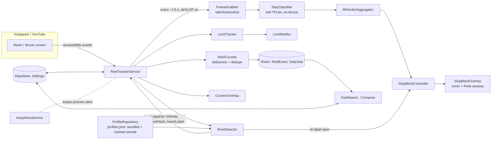
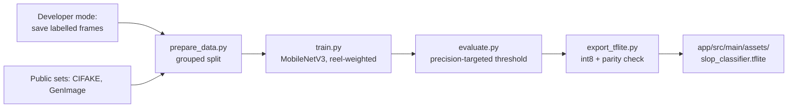

# Architecture

## Key ideas
- **App-specific knowledge is data.** View IDs, labels and package names live in `profiles.json`; a UI change in Instagram is a config fix.
- **Logic is pure where it can be.** `ReelCounter`, `LimitTracker`, `SlopBlockController`, and `MlVerdictAggregator` have no Android types and are unit tested.
- **Two block signals, one controller.** The label detector and the ML model both feed `SlopBlockController`, which owns the "peek" and "dismiss on next reel" behavior.
- **Everything stays on the device.** No analytics, no accounts; the optional remote config fetches a JSON file only.

## Training side

